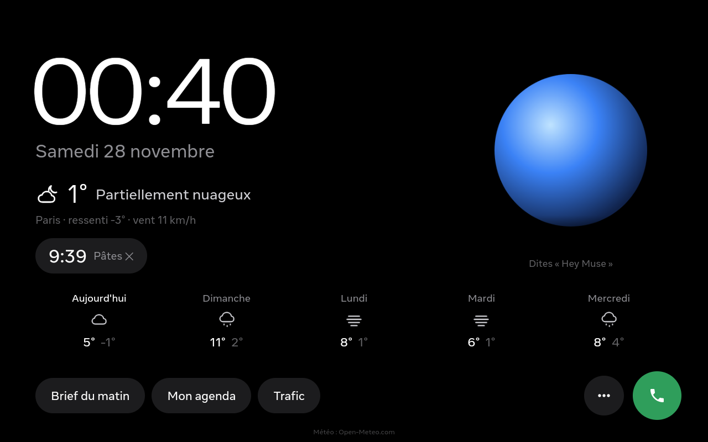
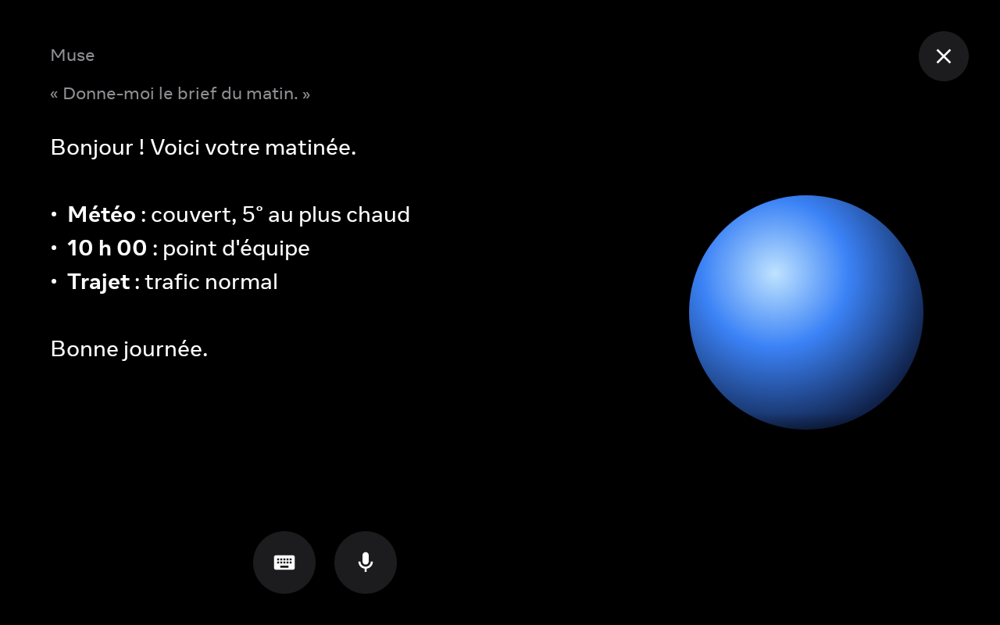
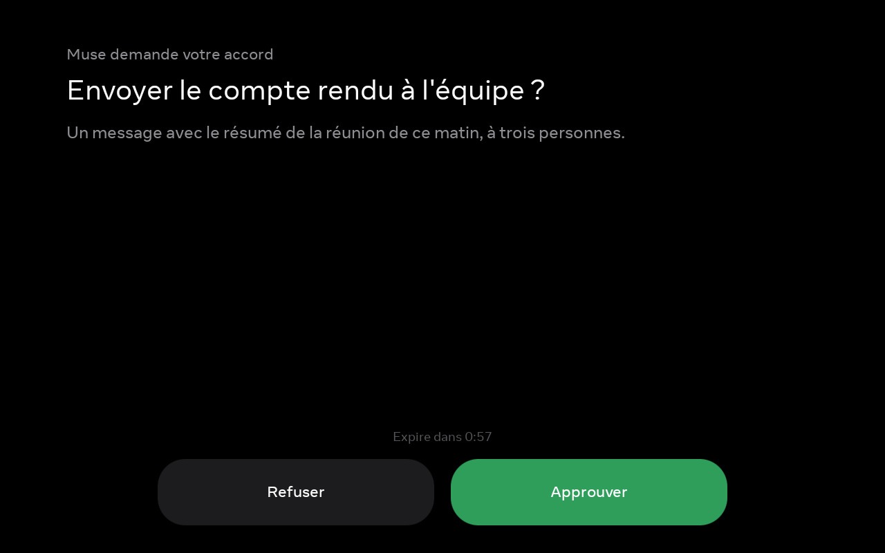
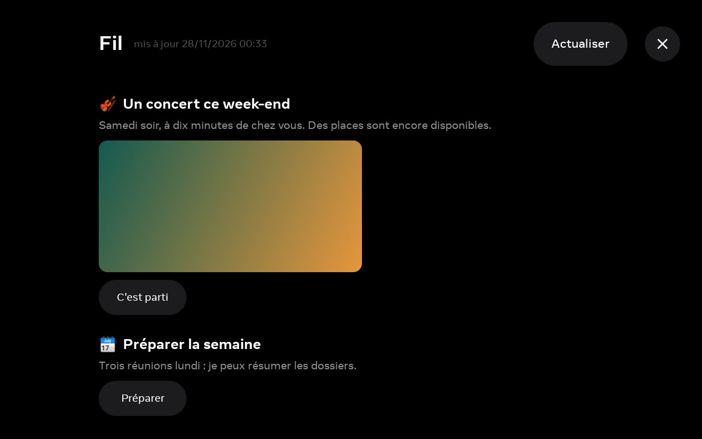
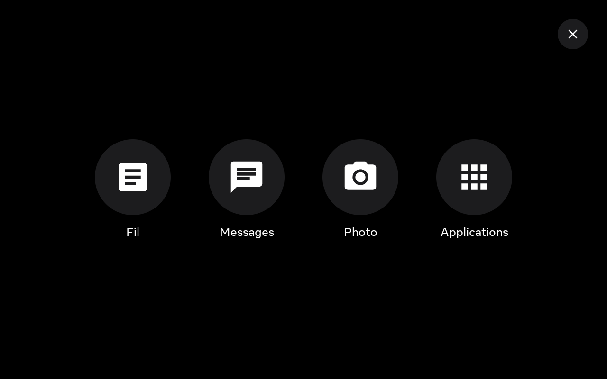

# Portal Muse

Turn a **Meta Portal 10"** into a [Muse](https://gadgets.muse.ai) gadget and a quiet home screen:
voice and video calls with your Muse, "Hey Muse" hands free, and a screen your Muse can use.

> **Unofficial project.** Not made, endorsed or supported by Meta. It is a Kotlin port of parts of the
> [muse-gadget-sdk](https://github.com/facebookincubator/muse-gadget-sdk), and it can break whenever
> the service changes. You need your own Muse account and your own SDK token, and you agree to Meta's
> Gadget SDK terms. Use it at your own risk.

The interface is in **French on a French device and in English everywhere else**, including the
messages the app sends to your Muse. More languages are a
[great first contribution](CONTRIBUTING.md#good-first-contributions).

## Screenshots

Taken on a Portal 10" (1280 × 800), French interface, with demo content: sample city, timer,
messages and suggestions, and a plain blue orb where your Muse's avatar appears.



| Written conversation | A request to approve |
|---|---|
|  |  |

| Feed | More |
|---|---|
|  |  |

## What it does

- **Home screen**: clock, date, weather (Open-Meteo), your Muse's animated avatar, up to four quick
  actions, running timers. It can also show a dashboard of your choice (any `http` or `https` URL).
- **Calls**: one button, with Muse's live video or voice only. "Hey Muse" wakes it, and you can say
  your question in one breath. The call ends by itself after a silence, or after a goodbye.
- **Written conversation**: replies on screen and read aloud, answers by voice or keyboard, photos
  you choose to send.
- **A screen your Muse can use**: pictures and pages, banners, approve / reject questions, an idle
  photo frame, night mode, a feed of suggestions, small sandboxed touch apps, timers and volume.
- **Proactive**: a few times a day (07:00, 12:00, 17:00, 20:00) the Portal asks your Muse what deserves
  the screen. Cards appear on the home screen, and between the photos of the idle screen with
  suggestions from the feed. This can be turned off.
- **One companion with your phone and computer**: ask your Muse, from anywhere, to leave a note or open
  a web page on the Portal; send what is shown back to your phone with one touch.
- **Wake-up alarms and radio**: alarms ring with a station or beeps; a fixed list of public streams.
- **Bluetooth LE** (off by default): your Muse can reach nearby devices, each one approved on screen.

### Status

| Area | State |
|---|---|
| Pairing from the Muse phone app, Noise session, reconnection | Tried on a real device |
| Written and spoken replies, voice calls, video calls, "Hey Muse", goodbye hang-up | Tried on a real device |
| Message history, photos you send, photo frame | Tried on a real device |
| Home screen, avatar, kiosk, restart after reboot, crash or update | Tried on a real device |
| Banners, questions, small apps, timers by voice, feed update | Tried with a real Muse, after teaching it the screen |
| Volume by voice | Tried on a real device |
| Automatic updates, cards on the home and idle screens, radio | Tried on a real device |
| Web page hand-off, send to phone, alarms, voice requests other than volume | New: unit tests only |
| Bluetooth, side chat | Unit tests only |
| Token rotation | Unit tests only |
| Other Portal models | Unknown |

## Requirements

- A Meta Portal 10" running **Android 10**, with ADB enabled (Settings > Debug; the Portal's settings
  may ask for a WhatsApp or Facebook account). ADB turns off at every reboot.
- A computer with Android Studio (JDK 17 or later), Android SDK 35, **NDK 28.2.13676358** and
  **CMake 3.22.1**.
- A Muse account with an SDK token (gadgets.muse.ai > Settings > SDK tokens).

The app never unlocks the bootloader and never removes or disables a system app.

## Build and install

Download and verify the wake word dependencies once (about 1.3 MB):

```bash
./tools/prepare-wakeword.sh
```

On macOS, use Android Studio's JDK:

```bash
export JAVA_HOME="/Applications/Android Studio.app/Contents/jbr/Contents/Home"
```

Run the tests and build:

```bash
./gradlew :core:test :app:assembleRelease
```

The release build is signed with your local Android debug key, and is not debuggable:

```bash
adb install -r app/build/outputs/apk/release/app-release.apk
```

```bash
adb shell monkey -p com.portalmuse.gadget -c android.intent.category.LAUNCHER 1
```

## First run

Open the **maintenance menu** by holding the bottom left corner for 2 seconds.

1. **Muse connection > Muse SDK token**: enter your token. To avoid typing it, touch the field, then
   run this on the computer; it types the token from your clipboard without showing it:

```bash
./tools/enter-token.sh
```

2. **Muse connection > Open Bluetooth pairing**. The Portal advertises as `MuseGadgetXXXXXX`.
3. In the Muse phone app: Settings > Devices (developer mode), pair it.
4. Allow the microphone when asked. Enable "Hey Muse" under **Voice and calls** if you want it.
5. **Screen > Allow the screen at startup** lets the kiosk come back after a reboot or a crash.

## Using it

The home screen has your quick actions, a **More** button (feed, messages, photo, apps) and the call
button. The menu has six sections: voice and calls, what Muse may do, screen, Muse connection,
information, and quit.

### Commands your Muse gets

| Commands | Effect | Allowed by |
|---|---|---|
| `device.health`, `device.guide` | Status and usage guide | always |
| `timer.*`, `audio.volume` | Kitchen timers and speaker volume | always |
| `display.show_images`, `show_page`, `close` | Pictures and static pages | screen |
| `display.notify`, `display.ask` | Banner; approve / reject buttons | screen |
| `home.set_cards`, `display.open_url` | Cards (home and idle screen); a public https web page | screen |
| `alarm.*`, `radio.*` | Wake-up alarms; radio from a fixed list | always |
| `display.night_mode`, `home.set_shortcuts`, `frame.set_photos` | Night, quick actions, photo frame | screen |
| `feed.set`, `apps.*` | Feed page; small touch apps | screen |
| `camera.capture` | One photo, only after two taps on screen | off by default |
| `ble.*` | Bluetooth LE; each new device approved on screen | off by default |

The guide your Muse reads is [`app/src/main/assets/guide.md`](app/src/main/assets/guide.md).

## How it works

```
core/   Pure Kotlin, JVM tested: BLE framing, pairing v5, Noise XX, the Muse session,
        chat, voice calls, video calls (SRTP, RTP, STUN, H.264), device commands.
app/    Android: kiosk activity, screens, microphone, camera, Bluetooth, services.
        app/src/main/cpp holds the SDK's "Hey Muse" detector.
tools/  Dependency download, token entry.
```

- **Pairing** uses the community mode of pairing v5. It protects against passive listening, not
  against an active man in the middle: pair at home.
- **Session**: a foreground service keeps a Noise session open, reconnects on its own and refreshes
  old tokens before reconnecting. The device registers as `linux` / `gadget`, model
  `portalmuse-portal-10`.
- **Replies** are followed on `/chat/subscribe`; they are spoken through `tts-stream`.
- **Video calls** are signalled over the session, then Opus audio and H.264 video go to the media
  endpoint the server gives, over SRTP. **No picture from the Portal is ever sent.** The light
  background of the video is blacked out on the device.
- **"Hey Muse"** runs on the device. Audio leaves it only after the word is heard. The model is
  English; the SDK measured about 74 % detections and 0.4 false wakes per hour on synthetic voices.
- **Feed**: a gadget has no access to the app's feed, so the Muse sends it with `feed.set`. Opening an
  empty feed, or one older than 3 hours, asks for it again (a message in your conversation, at most
  every 30 minutes).
- **Using the screen**: calls are announced as a `mcu-wearable`, the only device type the SDK admits
  for them, so a Muse may not think of the screen. **What Muse may do > Teach Muse to use this screen** sends it a
  message saying what the Portal can show. Your Muse's own permission requests stay on the phone: the
  gadget protocol has no way to answer them.
- **Night mode** only turns the light off; the device stays online and listening.
- **Handled by voice on the device**: during a call, a short sentence such as "turn it up", "stop the
  timer", "play the radio", "night mode" or "stop the alarm" is carried out by the Portal itself, which
  beeps and hangs up: a Muse does not always call the matching command.

Logs, which never contain message contents or tokens:

```bash
adb logcat -s PortalMuse PortalMuseBle
```

## Security and privacy

- No SDK token, device token or key belongs in the code or the repository. Tokens are entered on the
  device and encrypted with an Android Keystore key.
- Connections to Muse are limited to the hosts sent by the Muse app, without redirects. TLS roots the
  SDK treats as distrusted are removed from the trust anchors.
- No shell, file or microphone control is exposed to the Muse.
- The screen is shared: an approve button can be tapped by anyone nearby, and the answer is not
  authenticated. Keep confirmations for money, messages or deletions on your phone.
- Cards show personal information on a shared screen; turn the screen permission or the automatic
  updates off if that matters. A web page opened with `display.open_url` runs scripts in a WebView
  with no bridge to the app, no file, camera or microphone access, and only navigates to public https
  addresses.
- Pages and apps written by the Muse run in a WebView without network access. Pictures from the web
  must be `https` from public addresses; loading one reveals your home IP address to its host.
- Cleartext HTTP is allowed for a local dashboard.
- Found a security problem? Please do not open a public issue. Report it privately from the
  repository's **Security** tab ([report a vulnerability](https://github.com/ThatMuch/Muse_portal/security/advisories/new)).

## Not done

- Live dictation: the SDK firmware notes that the server's streaming dictation has no speech
  recognition behind it yet.
- Streaming a phone's screen or camera to the Portal: it needs the SDK's test app on the phone and an
  unauthenticated network port.

## License

[Apache License 2.0](LICENSE). Parts are ported or copied from the muse-gadget-sdk; see
[NOTICE](NOTICE). The wake word model has its own data credits in
[`ATTRIBUTION.md`](app/src/main/cpp/muse_wakeword/models/ATTRIBUTION.md).

"Meta", "Portal" and "Muse" are trademarks of their owner.
